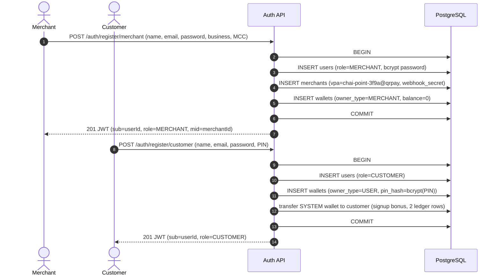
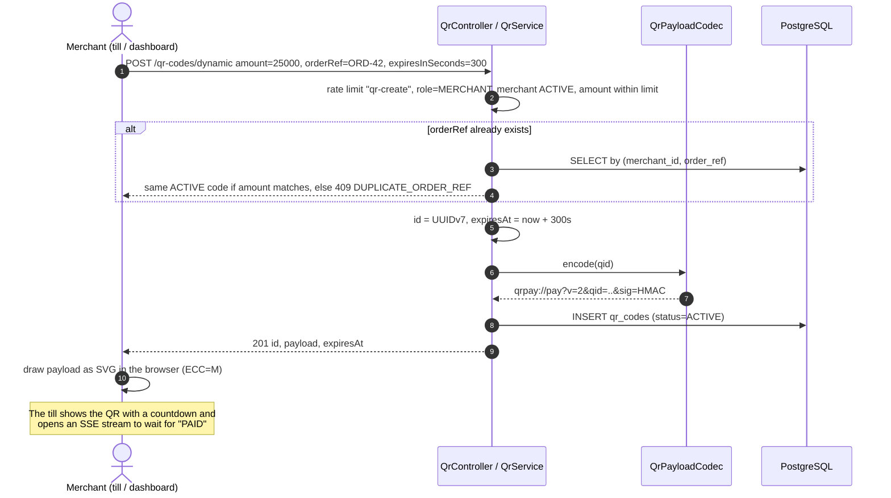
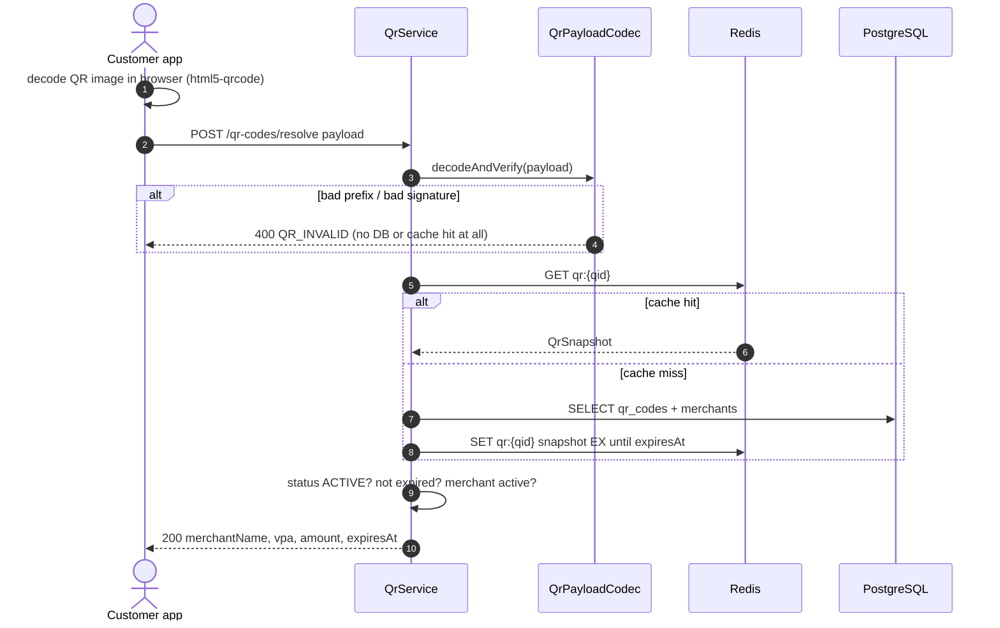
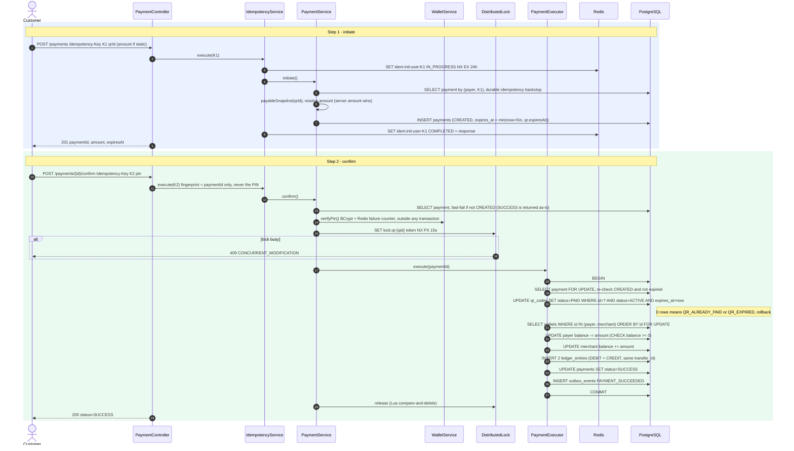
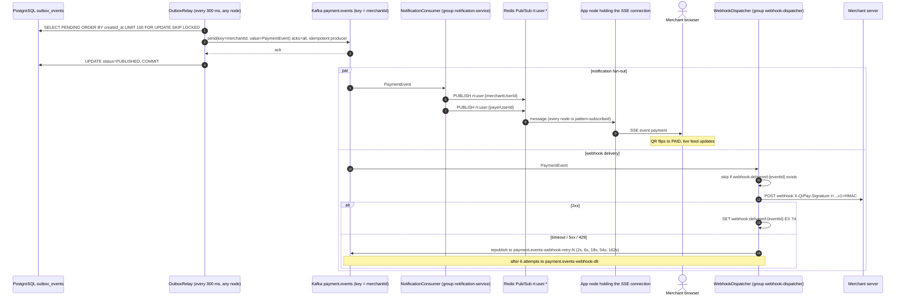
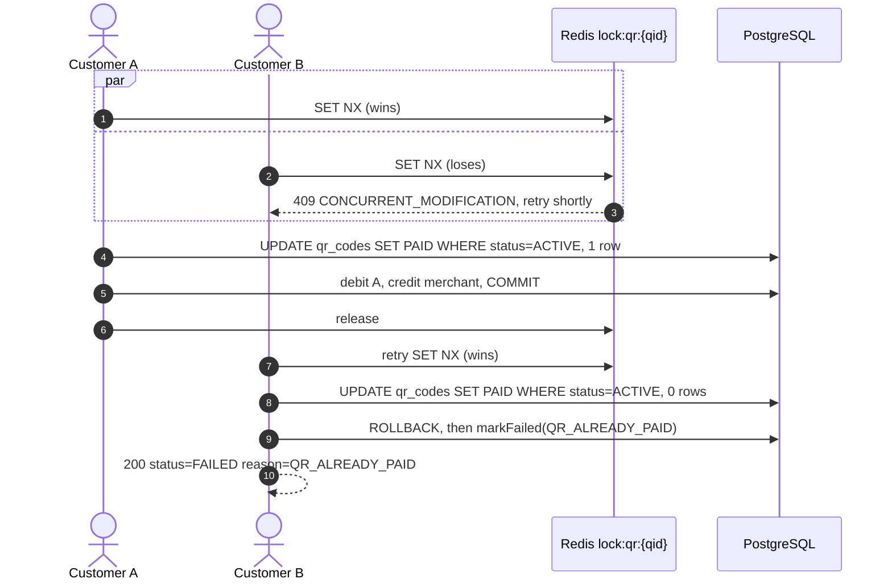
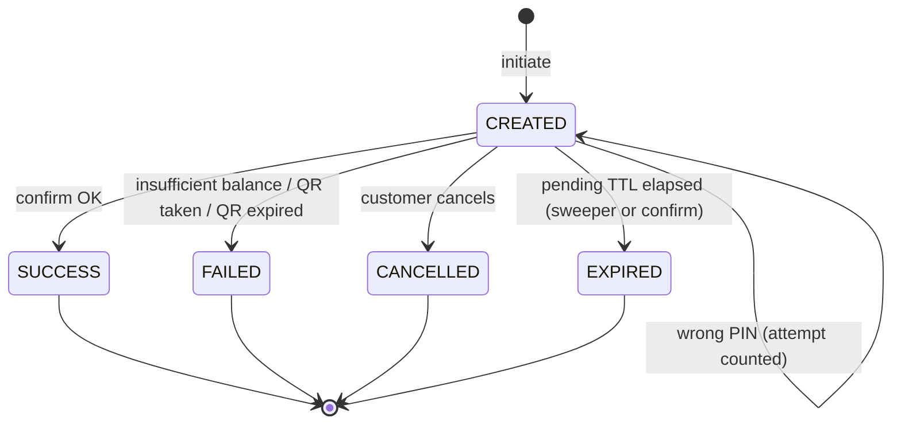
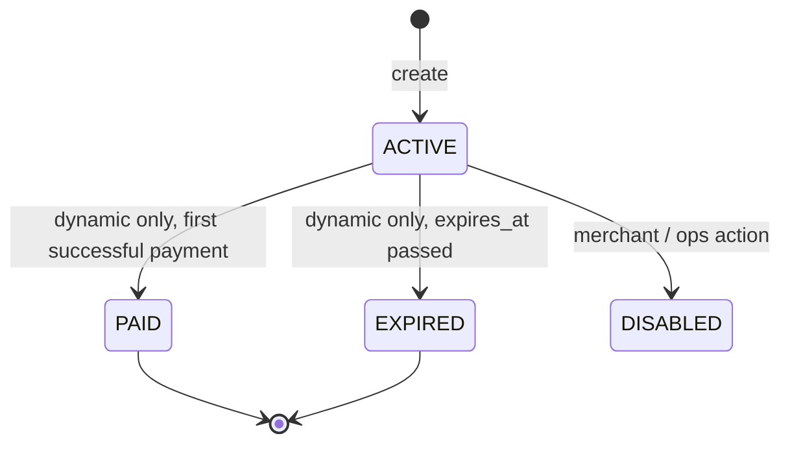

# 2. System flows

This document walks through every runtime flow end to end. Component names match packages in
`backend/src/main/java/com/qrpay/*`.

- [2.1 Onboarding & authentication](#21-onboarding--authentication)
- [2.2 Merchant generates a dynamic QR](#22-merchant-generates-a-dynamic-qr)
- [2.3 Customer scans & resolves](#23-customer-scans--resolves-the-qr)
- [2.4 Payment: initiate + confirm (the core flow)](#24-payment-initiate--confirm-the-core-flow)
- [2.5 After commit: events, real-time push, webhooks](#25-after-commit-events-real-time-push-webhooks)
- [2.6 Two customers, one dynamic QR (concurrency)](#26-two-customers-one-dynamic-qr-concurrency)
- [2.7 State machines](#27-state-machines)
- [2.8 Failure scenarios & how each is handled](#28-failure-scenarios)

---

## 2.1 Onboarding & authentication



* Everything one registration creates is committed in a **single transaction**, so a user can never exist without a wallet.
* The JWT carries `role` and `merchantId`, so later requests need **no session lookup** and the app tier stays stateless.
* The signup bonus goes through the same `transfer()` as a payment. The SYSTEM wallet goes negative, so the
  sum of all balances stays exactly 0.

---

## 2.2 Merchant generates a dynamic QR



**Payload format** - an unguessable pointer plus an integrity tag, nothing more:

```
qrpay://pay?v=2&qid=0199...&sig=Xy3...
```

| Param | Meaning |
|---|---|
| `v` | payload version, which lets the format evolve |
| `qid` | QR id, the pointer to the server-side record |
| `sig` | first 128 bits of HMAC-SHA256 over everything before `&sig=`, base64url |

**Why no payee, amount or expiry in the code.** This is a closed loop: only our own customer app
scans these codes, and it always round-trips `/qr-codes/resolve` before showing anything (there is
no URI parsing in the frontend at all). Carrying self-describing fields would therefore buy nothing
and cost twice: the code gets denser, and anyone who photographs it reads the merchant's VPA,
legal name and order value. Measured with ZXing at ECC-M, dropping them moves a dynamic code from
**204 bytes / QR version 10 / 57x57 modules** to **83 bytes / version 5 / 37x37** - at the fixed
320 px render that is 5.25 -> 7.80 px per module, which is the whole point: a code that scans in
poor light and from further away.

A truncated 128-bit MAC keeps the QR smaller still while remaining infeasible to forge.

> The self-describing shape only earns its bytes if a *third party* must pay without calling our
> API - which is exactly why the real UPI intent URI carries `pa` and `am`. If qrpay ever opens up
> to third-party PSP apps, those fields have to come back and this trade-off flips.

**v1 compatibility.** Codes minted before this change carried `mid`, `pa`, `pn`, `am`, `exp` and
`cu`. `decodeAndVerify` still accepts `v=1` and ignores the extra params, so a static QR printed
and stuck to a counter keeps working indefinitely. Stored payloads are never rewritten - a printed
code must keep matching its row.

---

## 2.3 Customer scans & resolves the QR



* **Everything shown comes from the server snapshot.** The payload carries no amount, payee or expiry
  to disagree with the database, and even a validly signed payload is only a pointer - the signature
  proves we issued this `qid`, not that it is still payable.
* The cache TTL is set to the QR's own expiry, so a dynamic QR's cache entry disappears exactly when it stops being payable.
  On `PAID` the key is evicted **after commit**.

---

## 2.4 Payment: initiate + confirm (the core flow)

A payment has two steps, like UPI "collect → authorise":

1. **Initiate.** Validate and create a `CREATED` payment. This is cheap and moves no money. It gives the customer a stable
   `paymentId` and a TTL while they type their PIN.
2. **Confirm.** Authorise with the PIN. The money moves in one atomic transaction.



**Why each step sits where it does**

| Decision | Reason |
|---|---|
| PIN check **before** the lock and the transaction | BCrypt takes ~70 ms on purpose. Holding a row lock during it would cut throughput on hot wallets. |
| Redis lock **around** the transaction | It stops 50 customers hammering one dynamic QR from all queueing on the same Postgres row lock. The loser gets a fast 409. The lock is an optimisation only: correctness comes from the next three rows. |
| `SELECT … FOR UPDATE` on the payment | Serialises confirm, cancel and the expiry sweeper for the same payment. |
| Compare-and-set on `qr_codes.status` | Exactly one transaction flips `ACTIVE → PAID`. Postgres re-evaluates the `WHERE` after acquiring the row lock. |
| Wallets locked **in id order** | Two concurrent transfers touching the same wallets can never deadlock. |
| Balance `CHECK` constraint | The database refuses a negative balance even if application code has a bug. |
| Outbox insert in the **same** transaction | The event exists if and only if the payment committed (no dual write). |

**Business failures** (insufficient balance, QR already paid or expired) roll the attempt back, then
`PaymentExecutor.markFailed()` records `FAILED` + reason and a `PAYMENT_FAILED` event in a **second short
transaction**. The API returns `200` with `status: FAILED`, because the request itself was valid.
**A wrong PIN** returns `422 INVALID_PIN` and leaves the payment `CREATED`, so the customer can retry until the lockout.

---

## 2.5 After commit: events, real-time push, webhooks



* The **two consumer groups** read the same topic independently. A slow merchant webhook can never delay a real-time push.
* **Why Redis Pub/Sub after Kafka?** Kafka hands each event to *one* instance of the notification group, but the
  merchant's SSE connection might be held by any instance. Redis Pub/Sub broadcasts to all instances, and whichever one holds
  the connection writes to it.
* **Non-blocking retries.** Failed webhooks go to delay topics instead of blocking the partition, so other merchants'
  webhooks keep flowing.
* **Fallbacks.** The merchant UI polls `GET /qr-codes/{id}` every 4 s whenever the stream is not live, so the till
  never gets stuck.

---

## 2.6 Two customers, one dynamic QR (concurrency)



Even if Redis were down (the lock fails open), both transactions would reach the compare-and-set and
Postgres would let exactly one of them update the row. As a third line of defence, a partial unique index
`ux_payment_success_per_dynamic_qr` makes a second `SUCCESS` row for the same dynamic QR impossible.
`PaymentFlowIntegrationTest.dynamicQrIsPaidExactlyOnceUnderConcurrency` runs 8 payers concurrently against real
Postgres, Redis and Kafka and asserts exactly one success.

---

## 2.7 State machines

### Payment



`PaymentStatus.canTransitionTo()` encodes this table, and `Payment.transitionTo()` refuses anything else.
When processing moves to an external PSP, the natural extension is `CREATED → PROCESSING → SUCCESS|FAILED`
driven by the PSP callback.

### QR code



Static QRs stay `ACTIVE` indefinitely and accept any number of payments.

---

## 2.8 Failure scenarios

| Scenario | What happens | Customer / merchant impact |
|---|---|---|
| Customer double-taps **Pay** | Same `Idempotency-Key`: the 2nd request gets `409 REQUEST_IN_PROGRESS` while the 1st runs, then a replay of the stored response. | Charged once. |
| Network drops after the server committed | App retries with the same key and gets the stored `SUCCESS` response (`Idempotent-Replayed: true`). Even without Redis, `confirm` on a `SUCCESS` payment returns it unchanged. | Charged once, sees success. |
| Insufficient balance | Transaction rolls back (QR claim included), payment → `FAILED`, `PAYMENT_FAILED` event. | Clear error, QR still payable by someone else. |
| Wrong PIN | `422 INVALID_PIN`, counter +1. After 5 failures, `423 PIN_LOCKED` for 15 min. | Can retry. |
| QR expires while the customer types the PIN | Confirm sees `expires_at <= now` in the transaction → `QR_EXPIRED` → `FAILED`. | Merchant generates a new QR. |
| App node crashes mid-transaction | Postgres rolls back the uncommitted transaction. The Redis lock expires after 15 s. | Nothing moved. Retry works. |
| Crash **after commit, before Kafka publish** | The event is safe in `outbox_events` (`PENDING`). Any surviving node's relay publishes it. | Notification a little late, never lost. |
| Crash after publish, before marking `PUBLISHED` | The event is re-published → consumers de-duplicate on `eventId`. | No visible duplicates. |
| **Kafka down** | Payments keep succeeding (Kafka is not in the transaction). Outbox rows accumulate and drain on recovery. The UI polling fallback keeps the till accurate. | Push and webhooks delayed. |
| **Redis down** | Cache → DB reads. Lock, rate limiter and idempotency store fail open to DB guards (row locks, CAS, unique constraints). PIN lockout counter unavailable (alert). | Slower, still correct. |
| **PostgreSQL primary down** | Payments fail fast (`500`) until failover to the synchronous standby (~30 s with Patroni). No committed data lost (RPO 0). | Brief outage of the write path. |
| Merchant webhook endpoint down | Retry topics with backoff over ~4 min, then DLT + alert. The payment itself is unaffected. | Merchant reconciles via API or replays from DLT. |
| Ledger bug or manual DB edit | `LedgerReconciliationJob` flags `net_balance != 0` or mismatched wallets via metrics and error logs. | Ops alerted within 5 min. |
