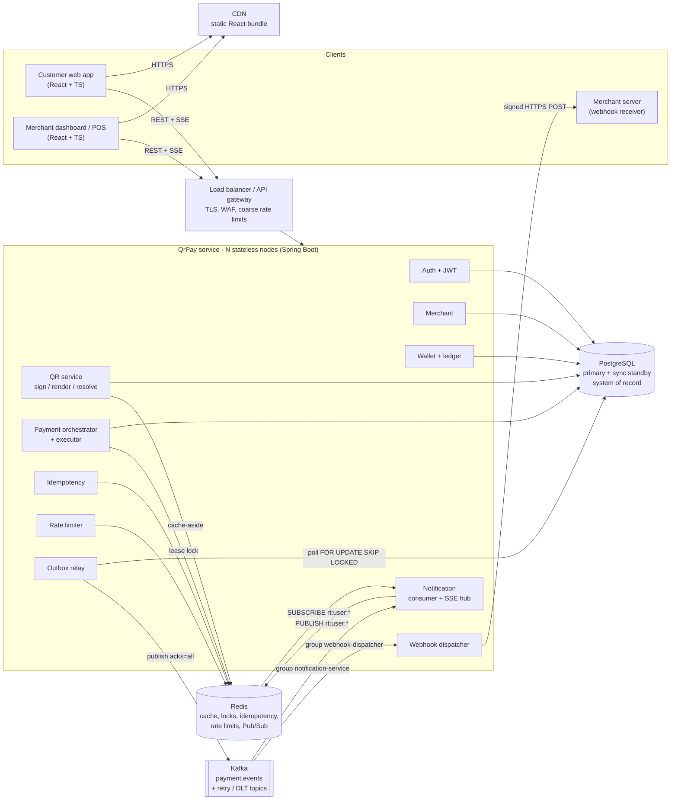
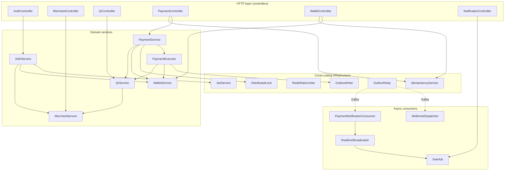
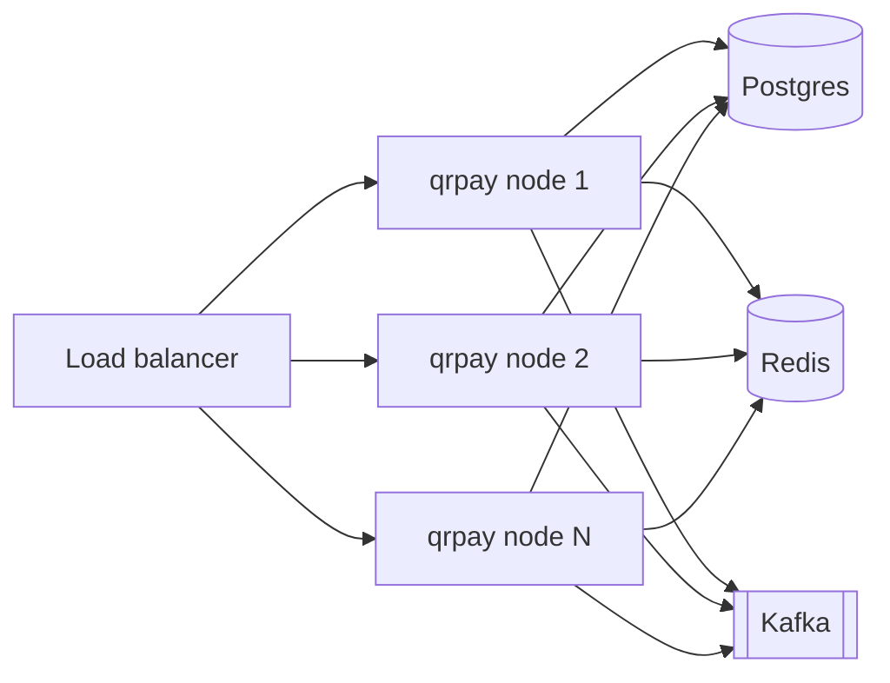
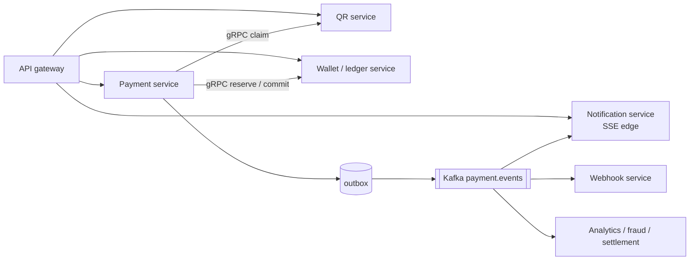

# 3. High-level design

- [3.1 Architecture overview](#31-architecture-overview)
- [3.2 Components and responsibilities](#32-components-and-responsibilities)
- [3.3 Internal module structure](#33-internal-module-structure)
- [3.4 Read path vs. write path](#34-read-path-vs-write-path)
- [3.5 Deployment view: from modular monolith to services](#35-deployment-view--from-modular-monolith-to-services)
- [3.6 Key design decisions](#36-key-design-decisions)

---

## 3.1 Architecture overview

**How to read it**

* **One synchronous critical path:** client → app → **PostgreSQL**. A payment's success depends only on Postgres.
* **Redis speeds things up and coordinates nodes.** Every Redis use has a database-backed fallback
  ([04 §4.3](04-components-and-technology-choices.md#43-redis--speed-layer-and-coordination)).
* **Kafka decouples everything that happens *after* money moved.** Notifications, webhooks and (later) analytics, fraud
  scoring and settlement all consume the same event stream without slowing down or endangering the payment.
* **All app nodes are identical and stateless.** Auth is a JWT, idempotency and locks live in Redis, and SSE fan-out goes
  through Pub/Sub, so any node can serve any request and nodes can be added or removed freely.

---

## 3.2 Components and responsibilities

| Component | Package | Responsibility | Talks to |
|---|---|---|---|
| **Auth** | `auth`, `security` | Registration, login, BCrypt password hashing, JWT issue/verify, role-based access (`CUSTOMER`, `MERCHANT`). | Postgres |
| **Merchant** | `merchant` | Merchant profile, VPA generation, webhook URL + secret. | Postgres |
| **QR service** | `qr` | Create dynamic/static QR, HMAC-sign payload, resolve scans, single-use claim, expiry. | Postgres, Redis (snapshot cache) |
| **Payment orchestrator** | `payment.PaymentService` | Two-step flow (initiate / confirm), amount rules, PIN check, distributed lock, maps business failures to `FAILED`. | QR, Wallet, Redis |
| **Payment executor** | `payment.PaymentExecutor` | **The one DB transaction** that claims the QR, moves money, updates status and writes the outbox event. | Postgres |
| **Wallet + ledger** | `wallet` | Wallets, double-entry `transfer()`, PIN verification with lockout, statements, reconciliation job. | Postgres, Redis (PIN counter) |
| **Idempotency** | `common.idempotency` | `Idempotency-Key` handling: claim, replay, conflict and misuse detection. | Redis |
| **Rate limiter** | `common.ratelimit` | Per-user / per-IP fixed-window limits via `@RateLimited("bucket")`. | Redis |
| **Distributed lock** | `common.lock` | Lease lock (SET NX PX + Lua release) for hot QR codes and singleton jobs. | Redis |
| **Outbox** | `outbox` | Persist events in the business transaction; relay them to Kafka at-least-once. | Postgres, Kafka |
| **Notification** | `notification` | Consume payment events, fan out via Redis Pub/Sub, push to browsers over SSE. | Kafka, Redis |
| **Webhook dispatcher** | `webhook` | Deliver signed events to merchant servers; non-blocking retry topics; DLT; dev sink. | Kafka, Redis, HTTP |
| **Expiry sweeper** | `payment.ExpirySweeper` | Periodically expire stale payments and dynamic QRs (one node at a time). | Postgres, Redis |
| **Customer app** | `frontend/src/pages/customer` | Wallet, scan (camera/upload/paste), review, PIN, receipt. | REST, SSE |
| **Merchant dashboard** | `frontend/src/pages/merchant` | Generate QR, live PAID flip, live feed, payments table, webhook settings. | REST, SSE |

---

## 3.3 Internal module structure

Dependencies point **one way**: controllers → services → infrastructure. The async consumers only know the
`PaymentEvent` contract (`events` package), never the payment internals. That boundary is what later lets
notification and webhook delivery become separate deployables with zero code changes in `payment`.

---

## 3.4 Read path vs. write path

| | Write path (money) | Read path (display) |
|---|---|---|
| Endpoints | `POST /payments`, `POST /payments/{id}/confirm`, `POST /wallets/me/top-up` | `POST /qr-codes/resolve`, `GET /payments`, `GET /wallets/me`, SSE |
| Consistency | **Strong**: serialisable effect via row locks and CAS | Resolve: cached, re-validated by the write path. Lists: read-your-writes from the primary. |
| Store | Postgres primary only | Redis (hot QR snapshot), Postgres (in production, history can go to read replicas) |
| Protection | Idempotency key, lock, rate limit, PIN | Rate limit |
| Scaling lever | Faster single transaction, partitioning, then sharding by wallet | Cache hit ratio, read replicas, more app nodes |

The cache is **never trusted for money**. `resolve` may show a slightly stale `ACTIVE`, but the confirm transaction
re-checks everything under lock.

---

## 3.5 Deployment view: from modular monolith to services

**Today: modular monolith.** One deployable, N identical replicas.

Why start here: the payment write is **one ACID transaction** spanning QR, wallet, ledger, payment and outbox.
Splitting those into services on day one would replace that transaction with a distributed saga, adding
complexity and failure modes before there is any scaling need. Modules are still cleanly separated, so the split can
happen later without a rewrite.

**Target: extract along the seams already in the code.**

| Extract first | Why it is easy | What changes |
|---|---|---|
| **Webhook service** | Already a pure Kafka consumer. | Nothing in payment. Owns a `webhook_deliveries` table. |
| **Notification / SSE edge** | Already a pure Kafka consumer + Redis Pub/Sub. | Scales independently on connection count (long-lived connections behave differently from request/response traffic). |
| **QR service** | Read-heavy, cacheable. | Claim becomes an API call; payment keeps a local copy of the amount. |
| **Wallet / ledger service** | Clear `transfer()` API. | Payment ↔ wallet becomes a two-phase *reserve → commit/release* (TCC) saga, with idempotent operations keyed by `paymentId`. |

---

## 3.6 Key design decisions

| # | Decision | Alternatives considered | Rationale |
|---|---|---|---|
| D1 | **PostgreSQL as system of record** | MySQL, MongoDB, Cassandra, DynamoDB | ACID multi-row transactions, row locks, `SKIP LOCKED`, partial unique indexes, CHECK constraints. See [04](04-components-and-technology-choices.md#41-postgresql--system-of-record). |
| D2 | **Double-entry ledger** + cached balance | Balance column only, event-sourced balance | Auditable, reconstructable. The balance column keeps reads O(1), and the ledger proves it. |
| D3 | **Two-step payment** (initiate → confirm) | Single call | Stable payment id while the PIN is typed. Idempotent retries. Maps to how real PSP "authorise" flows work. |
| D4 | **Signed id-only QR payload** (`v`, `qid`, `sig`) | Bare id with no signature, self-describing UPI-style payload | The server owns payee, amount and status, so shipping them in the code bought nothing and cost twice - a denser code (v10 -> v5, 57x57 -> 37x37 modules) and disclosure of the merchant's VPA and order value to anyone who photographs it. The MAC still rejects forgeries before any lookup. Self-describing payloads only pay off for third-party interop, which this closed loop does not have. |
| D5 | **Transactional outbox → Kafka** | Publish after commit, Kafka transactions, 2PC | No dual-write gap. No XA. Works with any database. Debezium CDC is the drop-in upgrade. |
| D6 | **Kafka** for events | RabbitMQ, SQS/SNS, Redis Streams | Durable replayable log, partition ordering, several independent consumer groups, huge throughput. |
| D7 | **Redis** for hot state & coordination | Memcached, Hazelcast, DB only | Atomic ops + Lua + TTL + Pub/Sub in one low-latency store. |
| D8 | **SSE** for real-time | WebSocket, long polling, FCM/APNs | One-directional server → client, plain HTTP, auto-reconnect, proxy-friendly. |
| D9 | **Fail-open infrastructure, fail-closed money** | Fail closed everywhere | Redis/Kafka outages degrade speed or latency, never correctness, because the DB enforces the invariants. |
| D10 | **Integer minor units** | `BigDecimal` / `NUMERIC` | Exact, fast, unambiguous across JSON, JS and Java. One currency per wallet. |
| D11 | **UUIDv7 ids, app-generated** | `BIGSERIAL`, UUIDv4 | Globally unique across shards, no DB round trip, time-ordered for index locality. |
| D12 | **Modular monolith first** | Microservices on day one | Keeps the payment an ACID transaction. Seams are ready for extraction ([3.5](#35-deployment-view--from-modular-monolith-to-services)). |
