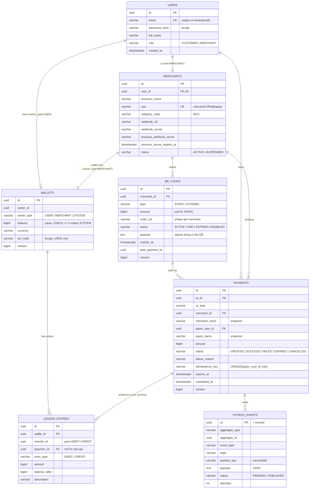

# 6. Data model

Source of truth: [`V1__init_schema.sql`](../backend/src/main/resources/db/migration/V1__init_schema.sql).

## 6.1 Entity-relationship diagram

## 6.2 Tables and why they look the way they do

### `users`
Credentials and role. `UNIQUE (lower(email))` makes email case-insensitive at the database level.

### `merchants`
A merchant **is** a user with role `MERCHANT` (1:1). `vpa` is the human-readable handle printed under the QR.
`webhook_secret` (`whsec_` + 48 hex chars) is generated at onboarding and can be rotated. A rotation moves
the old value to `previous_webhook_secret` and sets `previous_secret_expires_at`; while that window is open
deliveries are signed with both, so the merchant can reconfigure without dropping webhooks.

### `wallets`
* One wallet per `(owner_type, owner_id, currency)`.
* `balance BIGINT` in paise. `CHECK (balance >= 0 OR owner_type = 'SYSTEM')`: the database refuses overdrafts.
* `pin_hash` lives on the wallet (the PIN authorises spending *this* wallet, like a UPI PIN per bank account).
* `version` enables optimistic locking as a safety net. The payment path uses pessimistic `FOR UPDATE`.
* The SYSTEM wallet `00000000-0000-7000-8000-000000000001` is seeded by the migration.

### `qr_codes`
* `CHECK (type = 'STATIC' OR (amount IS NOT NULL AND expires_at IS NOT NULL))`: a dynamic code always has both.
* `ux_qr_static_per_merchant`, a **partial unique index** `(merchant_id) WHERE type='STATIC'`: exactly one static code per merchant.
* `ux_qr_order_ref`, `(merchant_id, order_ref) WHERE order_ref IS NOT NULL`: merchant order refs are idempotency keys for QR creation.
* `ix_qr_active_expiry`, `(expires_at) WHERE status='ACTIVE' AND type='DYNAMIC'`: the sweeper scans only live dynamic codes, so the index stays tiny.
* `payload` is stored so the image can be re-rendered identically at any time. Rows minted before the
  format was slimmed keep their `v=1` string and are never rewritten - a printed sticker must keep
  matching its row, and `decodeAndVerify` still accepts v1.

### `payments`
* **Receipt semantics:** `merchant_name`, `payer_name`, `order_ref`, `qr_type` are copied in at creation. History must
  not change if a merchant renames itself.
* `UNIQUE (payer_user_id, idempotency_key)`: the durable idempotency backstop.
* `ux_payment_success_per_dynamic_qr`, `(qr_id) WHERE status='SUCCESS' AND qr_type='DYNAMIC'`: the third line of
  defence against double-paying a single-use code.
* `ix_payments_pending_expiry`, partial on `status='CREATED'`: cheap expiry sweeps.
* `ix_payments_merchant_created` / `ix_payments_payer_created`: both history screens are a single index range scan.

### `ledger_entries`
Append-only (`@Immutable` in JPA; in production also `REVOKE UPDATE, DELETE`). `transfer_id` ties the DEBIT and CREDIT
of one transfer together. `balance_after` lets you render a statement without window functions and helps spot the exact
entry where a mismatch began.

### `outbox_events`
`id` **is** the `eventId` consumers de-duplicate on. `partition_key` = merchant id. The partial index on
`status='PENDING'` keeps relay polling O(pending), not O(history). Rows are purged 7 days after publishing.

## 6.3 Money & id types

| Choice | Why |
|---|---|
| `BIGINT` minor units | Exact integer arithmetic. `Math.addExact` / `subtractExact` in Java throw on overflow instead of wrapping. JS numbers are exact up to 2⁵³ (≈ ₹90 trillion). |
| `VARCHAR(3)` ISO currency | Explicit even though there is a single currency today. Wallet↔wallet transfers assert equal currency. |
| UUIDv7 | Globally unique across future shards, generated without a DB round trip, and time-ordered (48-bit ms prefix) so inserts land at the right edge of the B-tree like a sequence would. |
| `TIMESTAMPTZ` + `hibernate.jdbc.time_zone=UTC` | Instants, never local times. |

## 6.4 Invariants (and who enforces them)

| Invariant | Enforced by |
|---|---|
| No wallet (except SYSTEM) below zero | `CHECK` constraint + `Wallet.debit()` |
| Σ balance of all wallets = 0 | `transfer()` is the only mutator (always paired entries) + reconciliation job |
| Wallet balance = Σ its ledger entries | same, verified by the reconciliation job |
| A dynamic QR has ≤ 1 successful payment | compare-and-set on `qr_codes` + partial unique index on `payments` |
| One payment per (payer, idempotency key) | unique constraint |
| Payment status only moves forward | `PaymentStatus.canTransitionTo()` + row lock |
| Event exists ⇔ state change committed | outbox row in the same transaction |

## 6.5 Evolution: partitioning & sharding

1. **Partition by time** (native declarative partitioning) `payments`, `ledger_entries` and `qr_codes` monthly by `created_at`.
   UUIDv7 ids correlate with time, which keeps partitions balanced. Old partitions are detached and archived.
2. **Read replicas** for history, statements and dashboards.
3. **Shard by wallet id** when a single primary saturates (Citus, or application-level shards). A payment then spans
   two shards (payer, merchant). Keep the **payer debit synchronous** on the payer's shard, and credit the merchant
   **asynchronously** via the event stream (merchant settlement is naturally eventually consistent in real
   PSPs: T+0/T+1). See [07](07-scalability-reliability-security.md#72-scaling-the-database).
